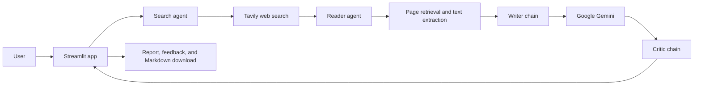

# Multi-Agent Research Assistant

A Streamlit research assistant that uses a LangChain-powered workflow to search the web, extract useful source content, draft a report, and review the result.

## Features

- Search for recent information with Tavily.
- Extract article content from selected web pages.
- Generate a structured research report with Google Gemini.
- Review the report with a separate critic chain and show its score and feedback.
- Inspect the search and extraction results, and download the report as Markdown.

## Technology

- Python 3.11
- Streamlit for the web interface
- LangChain and `langchain-google-genai` for agents and LLM chains
- Google Gemini for research writing and critique
- Tavily for web search
- Requests, Trafilatura, Readability, Beautiful Soup, and lxml for page retrieval and text extraction
- `python-dotenv` for loading local environment variables

## Requirements

- Python 3.11 and pip
- A Google Gemini API key
- A Tavily API key

## Installation

Clone the repository and move into the project directory:

```bash
git clone <repository-url>
cd Multi-Agent-Research-System-by-LangChain
```

Create and activate a virtual environment. On Windows PowerShell:

```powershell
py -3.11 -m venv .venv
.\.venv\Scripts\Activate.ps1
```
``` activate the conda in prompt: %USERPROFILE%\anaconda3\Scripts\activate.bat

after that these two line will be run:
conda create -n langagent python=3.11 -y
conda activate langagent
```

On macOS or Linux:

```bash
python3.11 -m venv .venv
source .venv/bin/activate
```

Install the dependencies:

```bash
python -m pip install --upgrade pip
python -m pip install -r requirements.txt
```

## Configuration

Create a `.env` file in the project root and add your API keys:

```dotenv
GEMINI_API_KEY=your_google_gemini_api_key
TAVILY_API_KEY=your_tavily_api_key
```

The `.env` file is ignored by Git. Keep API keys private and do not commit them.

## Run

Start the Streamlit application from the project root:

```bash
streamlit run app.py
```

Open the local URL printed by Streamlit, enter a topic, and run the research pipeline. The command-line entry point is also available:

```bash
python main.py
```

`main.py` currently runs the sample topic defined in that file.

## Architecture

The Streamlit app coordinates the stages and presents intermediate results, the report, and the critic's feedback. The search and reader stages are LangChain agents with tools; writing and review are prompt-and-model chains.



Core modules:

- `app.py` provides the Streamlit interface and runs the interactive workflow.
- `src/agents/agents.py` configures the Gemini model, search and reader agents, and writer and critic chains.
- `src/tools/tools.py` defines Tavily search and web-page extraction tools.
- `src/pipelines/pipeline.py` provides a reusable command-line research pipeline.
- `main.py` invokes the pipeline with a sample topic.

## Contributing

Contributions are welcome. Open an issue to discuss a bug or proposed change, then submit a pull request with a clear description and any relevant testing details.

## License

This project is distributed under the Apache License 2.0. See [LICENSE](LICENSE) for details.
